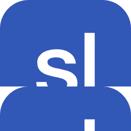

# Studio Local



**Your OpenAI API tools, inside your conversation.**

Studio Local is an open-source macOS MCP plugin.
Create images, edit with multiple references, make speech, transcribe audio and
run text requests using your own OpenAI API account. Choose the model and
supported quality or reasoning effort for each request in chat.

The idea is simple: keep working in one conversation while sending selected
jobs to the API. You control the API account and model choice; results are saved
on your Mac. There is no separate dashboard, hosted Studio service or localhost
web server. Studio Local is independent software and is not affiliated with or
endorsed by OpenAI.

**Release 1.1.1:** Apple Silicon Mac, macOS 13 or later, native CPython 3.11.
Intel Macs, Windows and Linux are not supported by this release.

## What it does

| Task | How Studio Local handles it |
| --- | --- |
| Generate an image | Send an approved prompt with your chosen image model and quality. |
| Edit an image | Send 1–16 ordered reference images in one request, with an optional mask for the first image. |
| Generate speech | Choose a speech model and voice, then save audio locally. |
| Transcribe audio | Send an approved local audio file and save the transcript. |
| Generate bulk text | Run a list of Responses API requests sequentially and save results, including partial progress on failure. |
| Discover models | Fetch model IDs available to your API key when you request it. IDs alone do not prove endpoint compatibility. |
| Check local usage | Read generation history and estimated Studio spend. This is not your account balance. |
| Set up a key | Get instructions for a masked prompt in your own Terminal. The key is never requested in chat. |

Video generation is not implemented. Model availability, supported parameters,
rate limits and prices depend on OpenAI and your account. There is no promise
that every returned model works with every tool.

## API credits, Pro and usage limits

As checked on **24 November 2026**, eligible paid ChatGPT Pro subscriptions can
claim monthly API credits: $100, $200 or $500 for the corresponding Pro tier.
The subscription must be at least seven days old; subscription and API
organization ownership and matching account email are required. Claim the
benefit in ChatGPT Billing or API Platform Billing, then use a project key from
the linked organization. The first grant is prorated; unused credits expire
with the billing cycle. See [OpenAI's eligibility and claim guide](https://developers.openai.com/api/docs/guides/chatgpt-api-credits).

These credits cover eligible Platform calls, including Images and Responses.
Studio Local uses those APIs, so our expectation is that eligible calls bill
against the linked organization's balance; OpenAI determines billing. **The
benefit excludes Codex usage through API keys and does not increase ChatGPT or
signed-in Codex limits.** Verify the benefit in your own billing settings.

Studio Local cannot refill a conversation's context window or keep the host
working after the host stops accepting requests. The host still runs the
conversation and tool orchestration. Use it to route selected generation work
through your API account, not to bypass subscription limits. API-key sign-in to
Codex is a separate billing mode. Read [Codex pricing and limits](https://learn.chatgpt.com/docs/pricing).

We never assume a $200 balance. The plugin reports local estimates and unpriced
jobs, not an authoritative remaining credit balance. Check [API billing](https://platform.openai.com/settings/organization/billing/overview)
and the [usage dashboard](https://platform.openai.com/usage) for account figures.
OpenAI may use purchased credits after free credits are exhausted, so review
your account's billing and recharge settings before generating.

## Install in Codex

You need a local Codex host with plugin/MCP support, a native Python 3.11
installation and an OpenAI project API key. Python is not bundled. The 34 pinned
application dependencies are included as public wheels, so setup does not fetch
packages from the internet.

1. Download the marketplace ZIP from this repository's Releases page and extract
   it, or clone the repository using the URL shown under Code. Open your own
   Terminal in the marketplace's root directory.

2. Create the private runtime and enter your key:

   ```sh
   python3.11 plugins/openai-studio/scripts/setup.py
   /bin/sh plugins/openai-studio/bin/studio setup-key
   ```

3. Register the marketplace and install the plugin:

   ```sh
   codex plugin marketplace add .
   codex plugin add openai-studio@studio-local
   ```

4. Restart the desktop app or begin a new Codex session. Mention Studio Local
   and ask it to create an asset.

Only type your key into the hidden prompt in **your own Terminal**. Do not paste
it into chat, a command argument, a screenshot or an agent-operated terminal.
Setup does not validate the key online or start a generation.

The display name is Studio Local. The internal ID remains `openai-studio` for
compatibility. Disable any older personal Studio server registration before
enabling this copy. Existing private data is not migrated automatically.
See the [detailed plugin guide](plugins/openai-studio/README.md) for removal,
private directories and model discovery.

## Can I use it in ChatGPT?

This package contains a **local stdio MCP server** and requires execution on
your Mac. The supported release workflow is local Codex. Other local MCP hosts
can run the server after setup, but their tool approval and rendering behavior
may differ.

ChatGPT desktop supports local execution for eligible desktop-only plugins;
official directory distribution of local MCP plugins requires approved-partner
access and review. This Git release is **not an approved ChatGPT directory
listing**. ChatGPT web and mobile cannot launch this local server. A remote MCP
deployment would be a separate product with different hosting and security
requirements. See [OpenAI's desktop-only plugin requirements](https://developers.openai.com/plugins/deploy/desktop-only).

## Example requests

- “Create an evening street scene with Studio Local. Ask me which available image model and quality to use.”
- “Edit these three approved reference images into one composition.”
- “Make a voiceover from this approved script. Let me choose the speech model and voice.”
- “Run these five writing prompts through the Responses API and save the results.”
- “Show my recent Studio jobs and local estimated spend.”

Before a generation, select a model and its supported options, then approve
the prompt and any attachments going to OpenAI. Consent to save a key is not
consent to upload files. Large jobs can incur API charges.

## Data and credentials

Credentials, runtime, history, approved inputs and generated files live outside
the repository in `~/Library/Application Support/Studio Local/`. The key is in
an owner-only **plaintext file**, not the macOS Keychain. Local file permissions
are not encryption. Never commit or share that directory.

The release includes public source, empty defaults, fake test fixtures and
pinned public dependencies. It excludes personal keys, history, account caches,
input files, generated assets and runtime directories. Generations send only
approved content to OpenAI; Studio Local has no separate hosted service or
telemetry. Read [Privacy](plugins/openai-studio/PRIVACY.md) and
[Security](plugins/openai-studio/SECURITY.md) for the actual boundaries and
limitations.

## Development and release checks

```sh
python3.11 tools/build_release.py
```

The builder uses an explicit public-file allowlist, verifies dependency hashes,
and creates plugin/marketplace ZIPs and SHA-256 checksums in ignored `dist/`.
It does not copy the working directory wholesale. The package manifest records
source hashes, and the launcher checks them before startup.

`tools/verify_release.py` tests a fresh relocated install, privacy canaries and
the offline test suite. Run it in a network-denying sandbox with this repository
as the project directory; its target test directory must not already exist.
See [verification evidence](plugins/openai-studio/audit/verification.md) and
[publishing guidance](PUBLISHING.md). Hashes detect changes; they are not signatures
or a guarantee that software has no vulnerabilities.

## License

Studio Local source is licensed under [MIT](LICENSE). Bundled dependencies retain their own licenses and
[notices](plugins/openai-studio/THIRD_PARTY_NOTICES.txt).

For a bug report, include your macOS/Python version, plugin version and a
redacted error. Do not include API keys, private prompts, source media, billing
details or your settings file. Review contributions for data handling and
outbound requests before submitting them.
