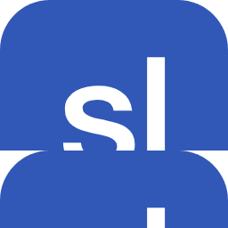

# Studio Local



Create images, speech and text using your own OpenAI API account. Choose models
and supported effort options in chat. Image edits accept up to 16 ordered
reference images. Studio Local is independent community software, not affiliated
with OpenAI. The marketplace repository's README explains API credit eligibility,
host usage limits and the difference between Codex and ChatGPT installation.

Version 1.1.3 supports **Apple Silicon Macs, macOS 13+, native CPython 3.11**.
Python itself is a prerequisite, not included. All 34 pinned application
dependencies are bundled as public wheels; setup and startup do not download
code. Intel is not supported by this release's dependency set.

## One-time setup

From this plugin directory, run these commands in your own Terminal:

```sh
python3.11 scripts/setup.py
/bin/sh bin/studio setup-key
```

The first command verifies the package and creates a private runtime using only
the bundled, hash-locked wheels. The second opens a hidden-input prompt. Never
paste the key into chat, an MCP elicitation form, a shell command argument or
an agent-operated terminal. Saving the key does not contact OpenAI, verify its
validity, fetch models or authorize a paid generation.

The key is stored in an **owner-only plaintext file**, not the macOS Keychain.
It never enters a tool argument or UI bridge. To remove it:

```sh
/bin/sh bin/studio remove-key
```

State, credentials, cached model IDs, approved inputs, generated outputs and the
runtime live in `~/Library/Application Support/Studio Local/`, outside this
package. The data directory is private (0700) and settings are owner-only (0600).
An explicit `OPENAI_STUDIO_DATA_DIR` can select a dedicated absolute directory;
symlinks, home/filesystem roots and paths overlapping the plugin are rejected,
including `..` paths and case aliases that refer to those locations. Do not point
it at another project. Release exports never copy this directory.

## Install from the marketplace

The marketplace repository contains `.agents/plugins/marketplace.json` and this
plugin under `plugins/openai-studio/`. From the repository root:

```sh
codex plugin marketplace add .
```

Restart the desktop app, open Plugins, choose the Studio Local marketplace and
install Studio Local. For a published Git repository, replace `.` with the Git
URL or `YOUR_ACCOUNT/YOUR_REPO`. The launch configuration uses `${PLUGIN_ROOT}`
and the recipient's private runtime; it contains no author-specific paths.

If upgrading from an older personal test installation, disable that copy and
its direct `mcp_servers.openai_studio` registration before enabling this one.
Do not run two copies of the server. This release deliberately does not read,
migrate or overwrite the old key, history or generated assets.

## Use in chat

Ask to set up Studio Local for status and the exact Terminal setup command.
There is no settings dashboard or localhost server. For each new generation,
Codex asks for a model and supported effort/quality choices, unless you already
provided them. Speech uses model/voice choices; transcription uses model choices.
These audio endpoints do not have reasoning-effort settings.

Ask to fetch available models to approve a metadata-only authenticated GET to
`https://api.openai.com/v1/models`. Returned IDs are cached; name-based groups
do not verify generation access or endpoint compatibility. Model references
are dated documentation, not live account limits. No admin key is needed.

Generation sends the approved prompt/text and named attachments to
`https://api.openai.com/v1`, authenticated with your own key. API usage is billed
by OpenAI. Key setup or model discovery alone does not authorize uploads.
`get_studio_state` reports the private input/output locations. Stage only approved
files there; the server cannot read arbitrary project directories or fetch URLs.

`edit_image.image_paths` takes 1-16 PNG/JPEG/WebP references in order: at most
25 MiB each and 100 MiB combined. An optional PNG mask must be smaller than
4 MB, match the first reference and applies to that reference. All references
are validated before one upload; each image is not a separate paid request.
Provider content, dimensional and model validation still applies.

Generated outputs are returned as local paths for display in chat. History keeps
job metadata and usage, not prompts or input paths. Text bulk requests run
sequentially with `store=false`, stop on failure/incomplete output and report
partial progress. Calls are not automatically retried. Local spend is an estimate;
unverified model rates and uncertain failures are marked unpriced. Actual prepaid
balance is unavailable through the documented project-key API and is never assumed.

## Verify and develop

`release-manifest.json` records source/wheel hashes and selected SDK source
hashes. The launcher verifies them before starting. Editing source requires a
review and a new manifest via the marketplace repository's `tools/build_release.py`.
Checksums detect changes; they are not signatures or a vulnerability guarantee.
Obtain the package and its checksum through a trusted channel.

The macOS sandbox keeps package/runtime files read-only and bounds writes to
private state/input/output and scratch folders. It permits outbound TCP 443;
the reviewed SDK hook restricts requests to `api.openai.com`. Proxies, redirects,
inherited API credentials and `.env` loading are disabled. No unrestricted
sandbox fallback exists. Tests use fake keys and mocked transport. See
`PRIVACY.md`, `SECURITY.md`, `audit/verification.md`, and third-party notices.

Source is MIT-licensed. Bundled dependencies retain their own licenses.
